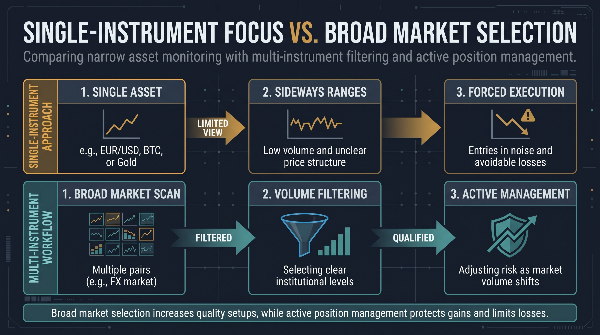

Many market participants build their daily trading routine around one financial instrument—for example, EUR/USD, BTC, or Gold. In theory, monitoring a single chart appears simpler and easier to manage. From the perspective of market mechanics, however, concentrating all execution on one asset creates a major structural limit. Institutional capital does not flow into any single asset continuously. Large banks, funds, and commercial entities shift liquidity across global markets based on economic schedules and cross-border payment needs, leaving any individual instrument in low-volume consolidation for large parts of the week.

When execution is restricted to one quiet instrument, standard technical setups become unreliable. Without heavy institutional orders driving clear direction, price moves inside narrow, uneven ranges formed mainly by short-term retail flow. Because only one chart is monitored, minor fluctuations inside a sideways range often get mistaken for real opportunities. Trades placed in low-volume conditions face higher relative spread costs, frequent false breaks, and inconsistent price movement. Even a tested strategy loses effectiveness when applied repeatedly to an asset lacking real institutional participation.

Broadening market coverage resolves this limit directly. Instead of waiting for one asset to form a setup—or forcing entries in sideways conditions—institutional desks scan multiple markets at once. In a broad market, for example foreign exchange, there are as many potential opportunities as there are active currency pairs. Because each pair reflects the economic data, monetary policy, and capital flows of two distinct regions, market volume never stops across all pairs simultaneously. While one popular instrument—such as Gold, BTC, or EUR/USD—moves sideways, clear price imbalances often develop elsewhere across currency pairs. Filtering a wider market keeps execution selective, focusing capital strictly where measurable institutional volume is active.

A high number of opportunities in markets such as foreign exchange does not eliminate the need for disciplined work after an order opens. Choosing from multiple currency pairs improves entry quality, yet leaving open positions unattended still exposes capital to avoidable risk. Market conditions shift continuously after execution as sessions change, economic data releases, and new institutional volume enters the market. A trade opened at a clear structural level can encounter opposing orders well before reaching its target. Active position management—adjusting stop-loss levels after structure confirms, lowering risk when price movement slows, taking partial profits, or exiting early when market logic changes—significantly increases overall profitability while minimizing losses.

Consistent, publicly documented trading statistics rarely result from watching one instrument daily and leaving fixed orders alone. Long-term performance depends on two connected steps: scanning a broad market to select levels backed by real volume, and actively managing every open position until it closes. Together, broad selection and active management turn execution into a measurable, repeatable process.
